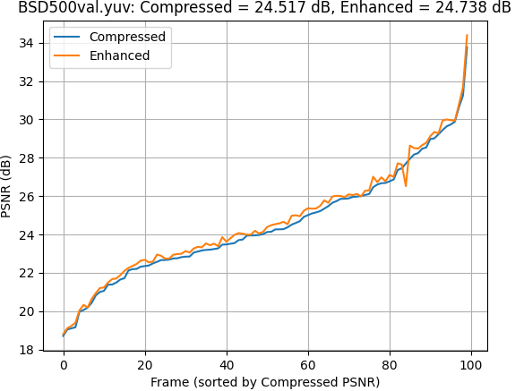
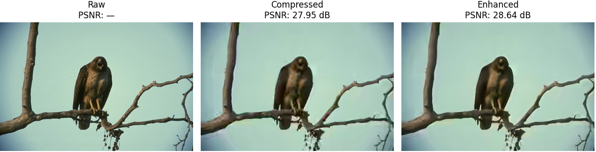

# Учебный проект, посвященный улучшению качества сжатых изображений при помощи нейронных сетей 

## Датасет
Для обучения используется датасет изображений BSD500 [1]. Изображения из датасета сконвертированы в формат yuv и хранятся в едином файле:
при этом 400 изображений 480x320 находятся в файле BSD500train.yuv, и 100 изобажений находятся в файле BSD500test.yuv. Оба файла сжаты кодеком x265 с индексом шага квантования QP=35 и 
помещены в файлы BSD500trainc.yuv и BSD500testc.yuv, соответственно.

## Код написан с использованием:
- Python 3.10.0
- torch==2.4.1+cu121
- numpy==1.26.4

## Эффективность базовой модели
Для улучшения качества изображений использовалась модель qecnn [2] на основе сверточных нейронных сетей. Эффективность работы базовой модели можно представить в виде графика ниже, где на оси x отмечены индексы изображения, а на оси y - значения PSNR, которые для наглядности 
отсортированы по возрастанию:

Как можно заметить, на 100 тестовых изображениях средний PSNR возрастает с 24.517 до 24.738 дБ, то есть выигрыш базовой модели относительно декодера H.265 составляет 0.221 дБ.

Пример работы модели, для изображения, на котором получен максимальный выигрыш по PSNR.

## Описание задания к лабораторной работе
Улучшить базовую модель qecnn так, чтобы модифицированная версия:
- выиграла на 100 изображениях из файла BSD500test.yuv в среднем 0.1 дБ и более у базовой модели по метрике PSNR, т.е. обеспечивала выигрыш 0.32дБ относительно декодера H265; 

Требования к реализации и результаты:
- Итоговый код должен быть представлен двумя файлами: support.py и файлом модели (по типу файла qecnn.py)
- При обучении и инференсе прямо и косвенно должны использоваться только изображения из папки файла BSD500train.yuv (т.е. модели, предобученные на других датасетах использовать нельзя)
- Построить график функции PSNR/номер изображения для исходной и модифицированной моделей
- Сравнить визуальное качество для базовой и предложенной моделях на характерных изображениях

На почту eabelyaev@itmo.ru прислать отчет в виде презентации в pdf формате, который включает в себя:
- ФИО студента, номер группы.
- Описание предложенной модификации с обоснованием, почему модификация даёт выигрыш.
- Графики для 100 изображений со значениями PSNR для x265, базовой и модифицированной моделей.
- Ссылку на репозиторий с исходным кодом и инструкцию по запуску.

## Литература
[1] https://github.com/BIDS/BSDS500 
[2] R. Yang et al., "Enhancing Quality for HEVC Compressed Videos," IEEE Transactions on Circuits and Systems for Video Technology, 2019.
[pdf](./doc/Enhancing_Quality_for_HEVC_Compressed_Videos.pdf)